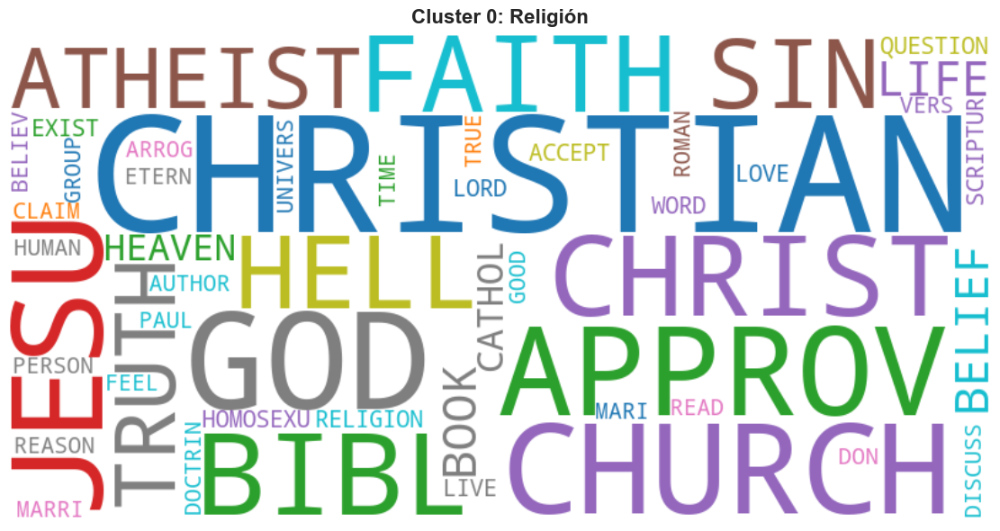
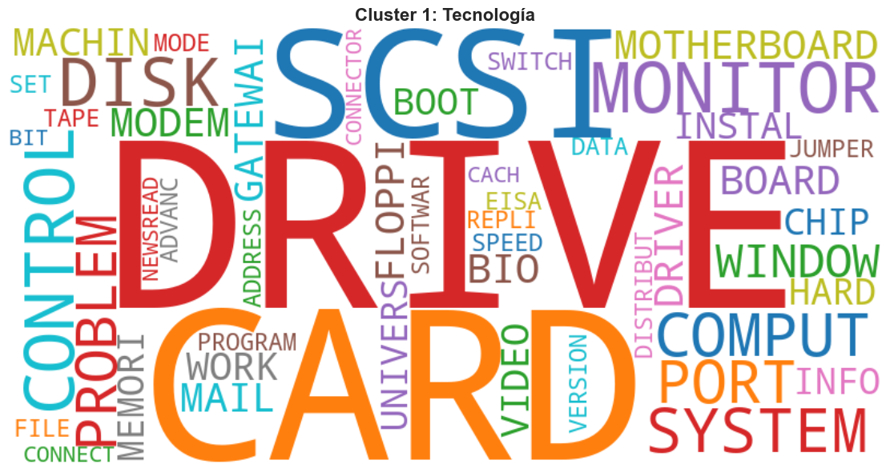
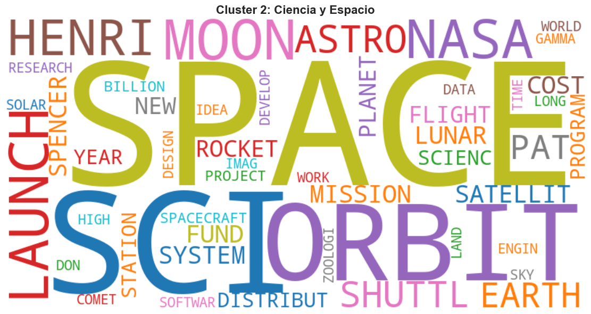
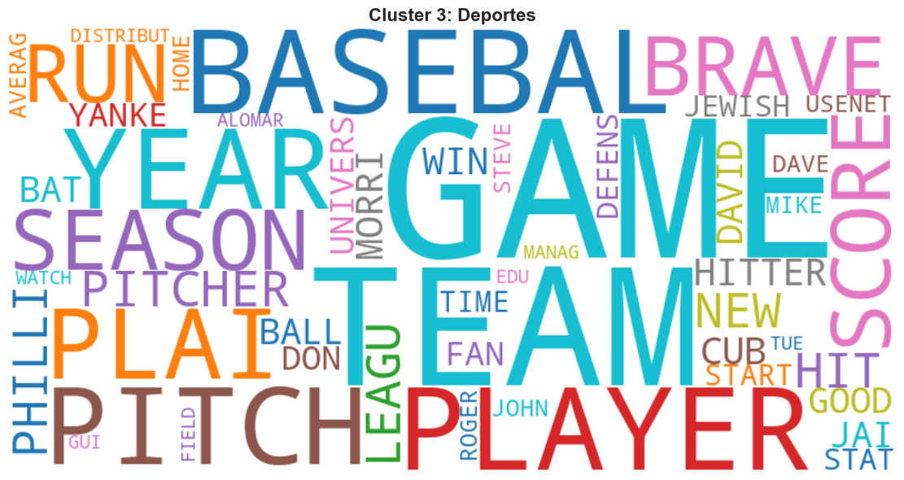

# Descubriendo temáticas en 3.000 documentos — Text mining y clustering

[English](README.md) · **Español**

> **Proyecto académico** · Máster en Ciencia de Datos e Inteligencia Artificial (MCDIA) · Afi Escuela · Curso 2025-26
> Módulo: *Unsupervised Learning* · Trabajo individual


**[Ver el notebook con los gráficos interactivos (nbviewer)](https://nbviewer.org/github/dmoyitacast/mcdia_unsupervised_learning/blob/main/code/unsupervised_learning_david_moya.ipynb)**. La vista previa de GitHub no muestra los gráficos de Plotly.

## Objetivo

A partir de un corpus de 3.000 documentos sin etiquetar, descubrir **qué temáticas contiene** usando solo técnicas no supervisadas: representar cada documento numéricamente, reducir la dimensionalidad y agrupar los documentos parecidos.

## Datos

`inputsTextMining/inputsTextMining2.csv`: 211.484 filas en formato `(documento, palabra, nº de apariciones)`. 3.000 documentos y un vocabulario de 20.529 palabras, ya reducidas a su raíz (*stemming*, p. ej. `DISTRIBUT`, `CHRISTIAN`).

## Metodología

| Fase | Qué se hace |
|---|---|
| **Validación de datos** | Tipos, valores nulos, duplicados, longitud de los documentos y distribución del vocabulario |
| **TF-IDF** | Cálculo de Term Frequency e Inverse Document Frequency desde cero con pandas |
| **Transition point** | Suma de TF-IDF por palabra; solo se conserva el **5% superior** (percentil 95): 20.529 → **1.027 palabras** |
| **Matriz documento-término** | Pivotado a una matriz de 3.000 × 1.027 normalizada por filas |
| **PCA** | Análisis de varianza explicada; **330 componentes** conservan ~70% de la varianza (−68% de dimensiones) |
| **K-Means** | Comparación de K entre 2 y 14 con inercia (método del codo) y Silhouette; mejor Silhouette en **K = 4** |
| **Validación** | Proyecciones t-SNE en 2D y 3D, palabras más representativas por cluster y nubes de palabras |

## Resultados

K-Means encuentra **4 clusters equilibrados** (~25% de los documentos cada uno) con una interpretación temática muy clara:

| Cluster | Temática | Palabras clave |
|---|---|---|
| 0 | **Religión** | CHRISTIAN, GOD, JESU, CHURCH, BIBL, FAITH |
| 1 | **Tecnología (hardware)** | DRIVE, CARD, SCSI, MONITOR, DISK, SYSTEM |
| 2 | **Ciencia y espacio** | SPACE, ORBIT, MOON, LAUNCH, NASA, SHUTTL |
| 3 | **Deportes (béisbol)** | GAME, TEAM, BASEBAL, PLAYER, PITCH, SEASON |

| | |
|---|---|
|  |  |
|  |  |

Los valores de Silhouette son bajos en términos absolutos (≈0,03), algo habitual en datos de texto dispersos y de alta dimensión. Aun así, la proyección t-SNE muestra regiones bien diferenciadas para cada temática, con algo de solapamiento entre *Deportes* y *Ciencia y espacio*.

## Estructura del repositorio

```
├── code/
│   └── unsupervised_learning_david_moya.ipynb   # Notebook con todo el análisis
├── inputsTextMining/
│   └── inputsTextMining2.csv                    # Dataset
├── images/                                      # Nubes de palabras usadas en este README
└── requirements.txt
```

## Cómo ejecutarlo

```bash
python -m venv venv
venv\Scripts\activate          # Windows  (source venv/bin/activate en macOS/Linux)
pip install -r requirements.txt
cd code
jupyter notebook unsupervised_learning_david_moya.ipynb
```

El notebook carga los datos desde `../inputsTextMining/`, así que hay que lanzarlo desde dentro de `code/`.

---

*Trabajo realizado como parte de la evaluación del Máster en Ciencia de Datos e Inteligencia Artificial de Afi Escuela. Calificación y enunciado no incluidos.*
