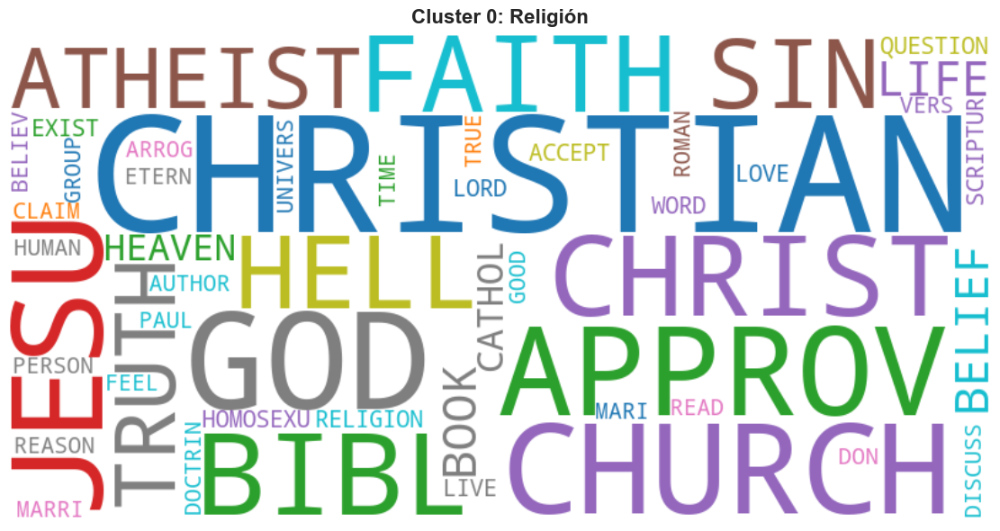
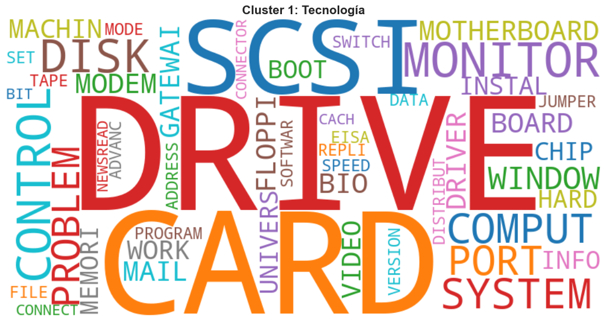
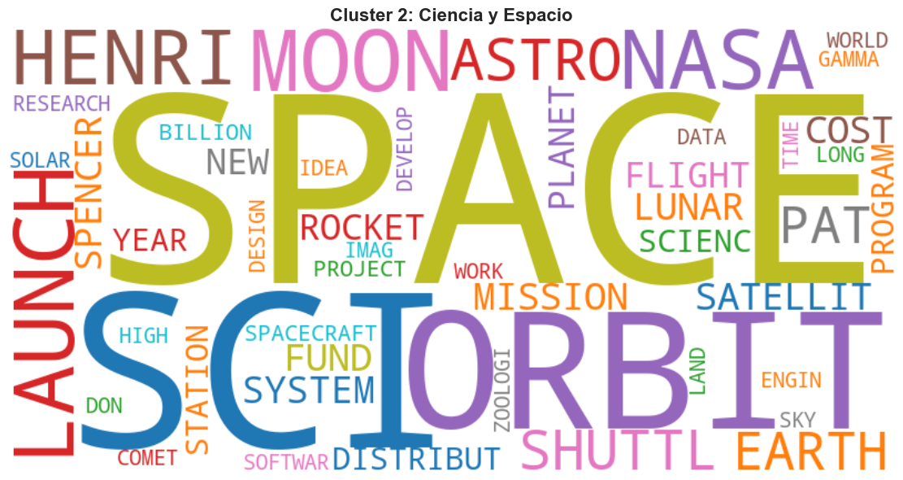
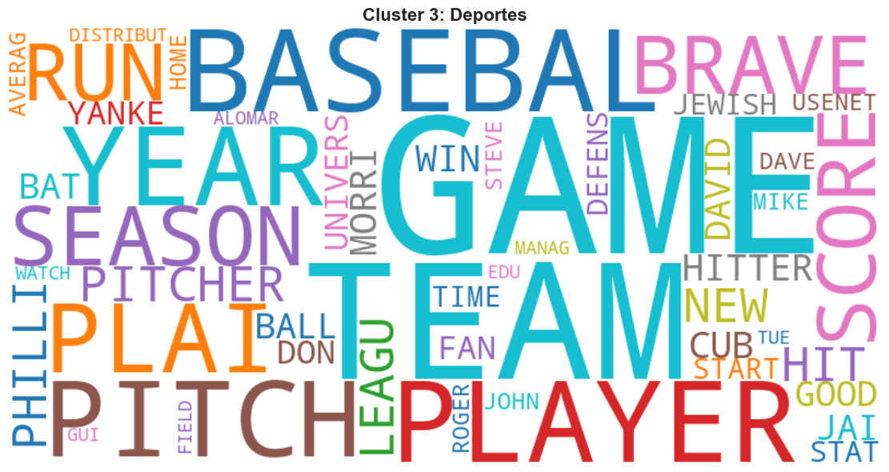

# Discovering topics in 3,000 documents — Text mining and clustering

**English** · [Español](README.es.md)

> **Academic project** · MSc in Data Science and Artificial Intelligence (MCDIA) · Afi Escuela · 2025-26
> Module: *Unsupervised Learning* · Individual assignment


**[View the notebook with interactive charts (nbviewer)](https://nbviewer.org/github/dmoyitacast/mcdia_unsupervised_learning/blob/main/code/unsupervised_learning_david_moya.ipynb)**. GitHub's preview does not render Plotly charts.

## Goal

Given an unlabelled corpus of 3,000 documents, find out **which topics it contains** using only unsupervised techniques: represent each document numerically, reduce dimensionality and group similar documents.

## Data

`inputsTextMining/inputsTextMining2.csv`: 211,484 rows in `(document, word, count)` format. 3,000 documents and a vocabulary of 20,529 words, already stemmed (e.g. `DISTRIBUT`, `CHRISTIAN`).

## Methodology

| Stage | What is done |
|---|---|
| **Data validation** | Types, missing values, duplicates, document length and vocabulary distribution |
| **TF-IDF** | Term Frequency and Inverse Document Frequency computed from scratch with pandas |
| **Transition point** | Aggregate TF-IDF per word; only the **top 5%** (95th percentile) is kept: 20,529 → **1,027 words** |
| **Document-term matrix** | Pivot to a 3,000 × 1,027 matrix with **L2** row normalisation (L1, suggested in the brief, was tested first but produced unbalanced, hard-to-interpret clusters) |
| **PCA** | Explained-variance analysis; **330 components** keep ~70% of the variance (−68% dimensions) |
| **K-Means** | K from 2 to 14 compared with inertia (elbow) and Silhouette; best Silhouette at **K = 4** |
| **Validation** | 2D and 3D t-SNE projections, top words per cluster and word clouds |

## Results

K-Means finds **4 balanced clusters** (~25% of documents each) with a very clear thematic meaning:

| Cluster | Topic | Top words |
|---|---|---|
| 0 | **Religion** | CHRISTIAN, GOD, JESU, CHURCH, BIBL, FAITH |
| 1 | **Technology (hardware)** | DRIVE, CARD, SCSI, MONITOR, DISK, SYSTEM |
| 2 | **Science & Space** | SPACE, ORBIT, MOON, LAUNCH, NASA, SHUTTL |
| 3 | **Sports (baseball)** | GAME, TEAM, BASEBAL, PLAYER, PITCH, SEASON |

| | |
|---|---|
|  |  |
|  |  |

Silhouette values are low in absolute terms (≈0.03), which is expected with high-dimensional sparse text data. Even so, the t-SNE projection shows well-separated regions for each topic, with some overlap between *Sports* and *Science & Space*.

## Repository structure

```
├── code/
│   └── unsupervised_learning_david_moya.ipynb   # Full analysis (in Spanish)
├── inputsTextMining/
│   └── inputsTextMining2.csv                    # Dataset
├── images/                                      # Word clouds used in this README
└── requirements.txt
```

## How to run

```bash
python -m venv venv
venv\Scripts\activate          # Windows  (source venv/bin/activate on macOS/Linux)
pip install -r requirements.txt
cd code
jupyter notebook unsupervised_learning_david_moya.ipynb
```

The notebook loads the data from `../inputsTextMining/`, so launch it from inside `code/`.

---

*Completed as part of the assessment for the MSc in Data Science and Artificial Intelligence at Afi Escuela. Grade and assignment brief not included.*
